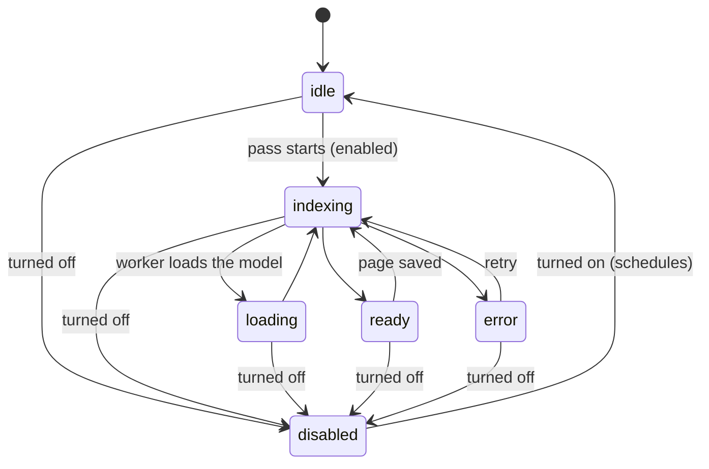

# Specification: Related pages context and settings

- **Specification ID**: 011
- **Date**: 2026-10-14
- **Slug**: related-pages-settings
- **Status**: Implemented
- **Owner**: Related pages context (`src/main/related/`), Settings page section (`src/renderer/settings/`)
- **Related Specification**: [010 — Settings page, alerts and window](010-2026-10-14-settings-alerts-window.md)

---

## Context & Background

Related pages find connections between pages with a local embedding model (EmbeddingGemma 300M, ONNX, `q4`) running in a worker thread, plus category and word overlap. On first use the worker downloads the model (about 300 MB) from Hugging Face into `userData/models`. Vectors are stored in `related_vectors`, OCR text from images in `related_ocr`.

The code predates the layered rule in AGENTS.md. It is four loose files in `src/main/`: `related-config.cjs` (constants), `related-engine.cjs` (documents and ranking), `related-service.cjs` (scheduling, SQLite, OCR pass, worker client, query) and `related-worker.cjs` (model and OCR helper). The IPC handlers `related:query` and `related:retry` live in `main.cjs`.

The service always runs. The user cannot turn it off, change how many connections appear or how strict they are, see which model is used, or free the disk space.

On 2026-10-14 the user chose to reorganize the code into a bounded context in this specification instead of approving an architecture exception.

---

## Problem Statement

### 1. The model download and indexing cannot be avoided

A user who does not want related pages still downloads about 300 MB and runs inference in the background.

### 2. The ranking is fixed

`limit` and `threshold` are code constants. A user with many similar pages sees too many weak connections; a user with few pages sees none.

### 3. The model is invisible

The user cannot see which model runs, where it came from, or how much disk it uses, and cannot remove it.

### 4. The code violates the layered architecture

`related-service.cjs` mixes scheduling, SQL, filesystem checks, the worker protocol and querying in one class. Adding settings to it would deepen the violation.

---

## Solution

### Part A: Related pages bounded context (no behavior change)

The four files and the two IPC handlers move into `src/main/related/`, with `domain/`, `application/`, `infrastructure/` and `presentation/` packages and a `compose.cjs`. The schema, vector cache, OCR cache, debounce, statuses (`idle`, `loading`, `indexing`, `ready`, `error`), ranking and IPC channels behave as before. Callers (`main.cjs`, tests, smoke runner, `scripts/capture-readme.cjs`, `scripts/check-embedding.cjs`) use the new modules; the old files are deleted.

### Part B: Notas relacionadas settings

The Settings page gets a third section, **Notas relacionadas**, after Alertas and Janela:

1. **Ativar notas relacionadas** (default on).
   - Off: the worker thread is terminated, nothing is scheduled, the model is never downloaded. Queries answer `disabled`, so the footer connections and the home graph disappear; the Relacionados dialog says "Notas relacionadas estão desligadas em Ajustes." Stored vectors and the downloaded model stay on disk.
   - On: indexing is scheduled as it is today.
2. **Quantidade de notas**: 3 to 12 (default 8). The home page keeps showing at most 4 of them, as today.
3. **Sensibilidade**: three levels mapped to the ranking threshold: **Ampla** (0.35), **Equilibrada** (0.40, default), **Estrita** (0.48).
4. **Restaurar padrão**: sets quantity and sensitivity back to 8 and Equilibrada (does not touch the on/off switch).
5. **Modelo** (read-only): name `embeddinggemma-300m-ONNX`, revision (short hash), quantization `q4`, source link to `https://huggingface.co/onnx-community/embeddinggemma-300m-ONNX` (opened through the existing validated `notebook:open-link`), disk usage of the model folder, and state: **Baixado**, **Baixando…** or **Não baixado**.
6. **Apagar cache e recalcular**: after a confirmation dialog, terminates the worker, waits for a running pass to stop, deletes the model folder and all rows of `related_vectors`. If related pages are on, indexing starts again (and downloads the model again); if off, everything stays empty. OCR text (`related_ocr`) is kept: it does not depend on the model.

---

## Practical Gains & Operational Outcomes

1. **Resource control**:
   - *Before*: a 300 MB download and background inference for every user.
   - *Now*: the user can turn it off and free the space.
2. **Relevant connections**:
   - *Before*: a fixed 8 connections at a fixed 0.40 threshold.
   - *Now*: 3–12 connections at one of three sensitivity levels.
3. **Transparency**:
   - *Before*: no information about the model.
   - *Now*: name, revision, source, size and state are visible.
4. **Architecture**:
   - *Before*: one class with every responsibility.
   - *Now*: pure domain (documents, ranking, preferences), use cases per file, adapters for SQLite, the worker and the model folder.

---

## User Stories

- [x] 1. As a user, I want to turn related pages off, so that the app does not download a model or run inference I do not use.
- [x] 2. As a user, I want related pages to stop appearing when they are off, so that the interface does not show an empty feature.
- [x] 3. As a user, I want to turn related pages back on without losing the earlier work, so that indexing resumes from the stored vectors.
- [x] 4. As a user, I want to choose how many related pages appear, so that the graph is as busy as I like.
- [x] 5. As a user, I want to choose a sensitivity level instead of a raw number, so that I understand what I am changing.
- [x] 6. As a user, I want to restore the default ranking, so that I can undo experiments.
- [x] 7. As a user, I want to see which model runs and where it came from, so that I trust what runs on my Mac.
- [x] 8. As a user, I want to see how much disk the model uses and whether it is downloaded, so that I know what it costs.
- [x] 9. As a user, I want to delete the model and vectors and start again, after confirming, so that I can recover from a broken download or free space.
- [x] 10. As a maintainer, I want related pages in their own layered context, so that changes stay inside clear boundaries.

---

## Architecture Gate

### 1. Bounded Context & Ubiquitous Language
- **Context**: Related pages.
- **Package Ownership**:
  - `src/main/related/domain/`: `model.cjs` (pinned model, ranking defaults, required model files, source URL), `documents.cjs` (searchable documents and content hashes), `ranking.cjs` (tokens, overlap, cosine, `rank`), `preferences.cjs` (`RelatedPreferences`, defaults, sensitivity levels, validation), `ports.cjs`.
  - `src/main/related/application/`: `indexing-scheduler.cjs` (debounce, single running pass, status, enabled gate), `index-pages.cjs` (one indexing pass: OCR, embeddings, pruning), `query-related.cjs`, `read-related-settings.cjs`, `update-related-settings.cjs`, `reset-related-ranking.cjs`, `clear-related-cache.cjs`.
  - `src/main/related/infrastructure/`: `sqlite-related-repository.cjs` (tables, vectors, OCR text, preferences in `settings`), `embedding-worker-client.cjs` (worker lifecycle and job protocol), `embedding-worker.cjs` (model and OCR helper, the worker thread), `model-folder.cjs` (size, state, removal of `userData/models`).
  - `src/main/related/presentation/ipc.cjs`: `related:*` and `settings:related-*` channels.
  - `src/main/related/compose.cjs`: wiring; returns `{ schedule, close, useCases, scheduler }`.
  - `src/renderer/settings/related-section.js`: the settings section; `related-ui.js` shows the disabled message.
- **Ownership decision**: related preferences belong to the Related pages context, not the Settings context. The Settings page only renders the section and calls the `settings:related-*` channels.
- **Ubiquitous Terms**:
  - `Related pages`: the connections shown in the note footer, the Relacionados dialog and the home graph.
  - `Indexing pass`: OCR of new images, embeddings of changed documents, pruning of stale vectors.
  - `Sensitivity`: `broad` (Ampla, 0.35) | `balanced` (Equilibrada, 0.40) | `strict` (Estrita, 0.48).
  - `Model cache`: the files under `userData/models` plus the `related_vectors` rows.

### 2. Aggregate Root & State Transitions
- **Entities & State Machine**: `RelatedPreferences` is a value object `{ enabled, limit, sensitivity }`, defaults `{ true, 8, 'balanced' }`. The scheduler status:



- **Invariants**:
  - While disabled, no worker thread exists and `schedule()` does nothing.
  - `limit` is an integer 3–12; `sensitivity` is one of the three levels.
  - Clearing the cache never overlaps a pass that writes vectors.
  - Deleting is confined to `userData/models`; no path comes from the renderer.

### 3. Commands, Queries & Domain Ports
```javascript
/** @typedef {{ enabled: boolean, limit: number, sensitivity: 'broad'|'balanced'|'strict' }} RelatedPreferences */
/** @typedef {{ name: string, revision: string, quantization: string, sourceUrl: string, bytes: number, state: 'downloaded'|'downloading'|'absent' }} ModelInfo */
/** @typedef {{ snapshot(): object, file(blobId: string): string|null }} PageSourcePort */
/** @typedef {{ vector(id: string): { hash: string, model: string }|undefined, vectors(model: string): { id: string, hash: string, vector: number[] }[], saveVector(id, hash, model, vector): void, pruneVectors(activeIds: Set<string>): void, clearVectors(): void, ocrText(): Record<string, string>, imagesWithoutText(): string[], saveOcr(blobId: string, text: string): void, preferences(): Partial<RelatedPreferences>, savePreferences(changes: Partial<RelatedPreferences>): void }} RelatedRepositoryPort */
/** @typedef {{ embed(text: string): Promise<number[]|null>, recognize(file: string): Promise<string>, canRecognize(): boolean, stop(): Promise<void> }} EmbeddingEnginePort */
/** @typedef {{ info(): { bytes: number, complete: boolean }, remove(): void }} ModelFolderPort */
```
- **Queries**: `queryRelated(noteId)` → `{ status, results }` (`status: 'disabled'`, `results: []` while off); `readRelatedSettings()` → `{ preferences, model: ModelInfo }`.
- **Commands**: `updateRelatedSettings(changes)`, `resetRelatedRanking()`, `clearRelatedCache()`; each returns `readRelatedSettings()`. At startup, `compose.cjs` reads the stored preferences before the first `schedule()`.

### 4. IPC Contract & External Input Validation

| Channel | Preload function | Payload | Result | Errors |
| :--- | :--- | :--- | :--- | :--- |
| `related:query` (moved, unchanged) | `related(id)` | note id | `{ status, results }`; `status: 'disabled'` while off | unchanged |
| `related:retry` (moved, unchanged) | `relatedRetry()` | none | none | none |
| `settings:related-read` | `relatedSettings()` | none | `{ preferences, model }` | none |
| `settings:related-update` | `updateRelatedSettings(changes)` | object with 1–3 of `enabled`, `limit`, `sensitivity` | `{ preferences, model }` | `Ajuste inválido.` |
| `settings:related-reset` | `resetRelatedRanking()` | none | `{ preferences, model }` | none |
| `settings:related-clear` | `clearRelatedCache()` | none | `{ preferences, model }` | `Não foi possível apagar o cache do modelo.` |
| `related:updated` (main → renderer, unchanged) | `onRelatedUpdated` | none | none | none |

- Every channel accepts only the app window as sender.
- `settings:related-update` validation: plain object; no keys outside the three; at least one; `enabled` boolean; `limit` integer 3–12; `sensitivity` in the enum.
- The confirmation for clearing is a renderer dialog in the paper style; the main process does not prompt.

---

## Implementation Decisions

1. Part A first, guarded by the existing related tests (moved to the new modules), then Part B test-first.
2. Storage reuses the `settings` table: `related_enabled`, `related_limit`, `related_sensitivity`.
3. `domain/model.cjs` keeps the model, revision, weights, floors and default `limit`/`threshold`; stored preferences override only `limit` and `threshold`.
4. Disk usage sums the files under `userData/models` in the main process (a few files, bounded).
5. Model state: `downloaded` when every required model file exists (the same list the worker checks), `downloading` when the scheduler status is `loading`, otherwise `absent`.
6. The section refreshes model info on `related:updated` while the page is open.
7. The smoke runner and the screenshot script reach the scheduler (`status`, `runNow()`) and the engine (`recognize`) through `compose.cjs`, not through private fields.
8. Files follow the 250-line target; domain files import nothing from Electron, `node:sqlite`, `fs`, `worker_threads` or `@huggingface/transformers`.

---

## Testing Decisions

Prior art: `tests/related.test.cjs`, `tests/related-smoke.js`, `tests/settings*.test.cjs`.

### Unit & Profile Tests
- Existing ranking and document tests run against the domain modules unchanged.
- Preferences: defaults; sensitivity maps to 0.35 / 0.40 / 0.48; `limit` and `sensitivity` validation.
- `rank()` with the configured limit and threshold returns at most `limit` results above the threshold.

### Integration & Contract Tests
- The existing SQLite cache test (reuse after reopening, re-embedding only edited content, trash excluded) runs through `compose.cjs` with a fake engine.
- Turning off stops the engine, makes `schedule()` a no-op and `queryRelated` answer `disabled`; turning on schedules a pass.
- `clearRelatedCache()` removes the model folder and `related_vectors`, keeps `related_ocr`, and schedules a pass only when enabled.
- Preferences persist after reopening and apply at startup.
- IPC: channel list, sender check, update validation (unknown keys, `limit` 2 / 13 / 4.5, unknown sensitivity, non-boolean `enabled`).

### Error Safety & UI Tests
- Smoke: turning related pages off hides the footer connections and the home graph and shows the disabled message in the dialog; turning on shows them again.
- Smoke: the model block shows name, revision, `q4`, the source link, size and state.
- Smoke: "Apagar cache e recalcular" asks for confirmation; cancelling deletes nothing; confirming deletes the vectors.

### Regression Tests
- `npm test`, `--related-only`, `--settings-only` and the production-boundary test pass.

---

## Acceptance Criteria

- [x] 1. The related-pages code lives in `src/main/related/` with the four layers; the old loose files are gone and behavior is unchanged.
- [x] 2. Turning related pages off stops the worker, prevents the download and hides the connections; turning on resumes.
- [x] 3. Quantity (3–12) and sensitivity (three levels) change the results; **Restaurar padrão** returns to 8 / Equilibrada.
- [x] 4. The model block shows name, revision, `q4`, source link, disk usage and state.
- [x] 5. **Apagar cache e recalcular** confirms, deletes the model and vectors, and re-indexes only when enabled.
- [x] 6. All settings survive a restart.
- [ ] 7. All unit, integration and regression tests pass.
- [ ] 8. Quality checks (`npm test` on Node 22+, `node --check` on changed files, affected smoke suites) pass with 0 errors.

---

## Out of Scope

- Choosing another model, changing ranking weights or the semantic floor/ceiling.
- Deleting OCR text.
- Changes to the related-pages renderer beyond the disabled message.

---

## Further Notes

- Depends on specification 010 (the Settings page).
- The language specification becomes 012.

---

## Implementation Record

- **Part A (reorganization)**:
  - Moved: `related-config.cjs` → `domain/model.cjs` (now also lists the model files and the source URL); `related-engine.cjs` → `domain/documents.cjs` + `domain/ranking.cjs`; `related-worker.cjs` → `infrastructure/embedding-worker.cjs`.
  - Split out of `related-service.cjs` (deleted): `application/indexing-scheduler.cjs`, `application/index-pages.cjs`, `application/query-related.cjs`, `infrastructure/sqlite-related-repository.cjs`, `infrastructure/embedding-worker-client.cjs`.
  - `presentation/ipc.cjs` now owns `related:query` and `related:retry`, which check the sender and the note id.
  - Callers updated: `main.cjs`, `tests/related.test.cjs`, `tests/boards-store.test.cjs`, `tests/smoke/run.cjs`, `scripts/capture-readme.cjs`, `scripts/check-embedding.cjs`.
- **Part B (settings)**:
  - `domain/preferences.cjs`, `domain/model-info.cjs`, `infrastructure/model-folder.cjs`.
  - Use cases `read-related-settings`, `update-related-settings`, `reset-related-ranking`, `clear-related-cache`.
  - The scheduler gained an enabled gate, `settled()` and `restart()`.
  - Renderer: `src/renderer/settings/related-section.js`, the `#related-clear-dialog` confirmation, and the disabled message in `related-ui.js`.
- **Tests**:
  - `tests/related-settings.test.cjs`: defaults, model info, count and sensitivity with vectors scored between the thresholds, validation, reset, on/off, startup disabled, clearing, and clearing while a pass runs.
  - `tests/related-ipc.test.cjs`.
  - The Notas relacionadas part of the `--settings-only` smoke suite: model block, off hides the footer and the dialog explains why, on restores, count/sensitivity/reset, and clearing (cancel and confirm).
- **Verification (2026-10-14, macOS, Node 22.23.1)**:
  - `npm test`: 249 passing.
  - `node --check` on changed files.
  - Smoke `--related-only`, `--settings-only` and `--pipelines-only` pass.
  - The default suite still stops at the diagram failure that predates spec 010.
  - Not run: `--related-runtime-only` and `scripts/check-embedding.cjs` (both download the real model) and `scripts/capture-readme.cjs` (README screenshots).

### Deviations

1. Part A had no red phase of its own: the existing related tests were first pointed at the new modules (failing until the modules existed), then the code moved. The sender and note-id checks added to `related:query`/`related:retry` were tested after the move, in `tests/related-ipc.test.cjs`.
2. The smoke suite checks the footer connections and the Relacionados dialog when related pages are off. It does not check the home graph directly: the home graph hides itself when a query returns no results, and a disabled query returns none.
3. In smoke tests, indexing passes are replaced with no-ops (`related.scheduler.pass`) so the model is never downloaded. This is the same kind of harness override as the existing `related.scheduler.status = 'ready'`.

### Review fixes (2026-10-15)

Each fix started from a failing check in the `--settings-only` smoke suite.

1. **Controls after a failed save**: after a failed save, the Notas relacionadas section now puts its controls back to the stored values, as the Alertas section does.
2. **Source link failure**: the Hugging Face link goes through `openRelatedSource`. When the link cannot be opened, the page shows the notice "Não foi possível abrir o link." instead of leaving an unhandled rejection.

### Approval (2026-10-15)

The user verified the Notas relacionadas section in the running app and approved the specification. Still open at approval: criteria 7–8, because the default and `--mac-shell-only` smoke suites still stop at failures that predate specification 010.

