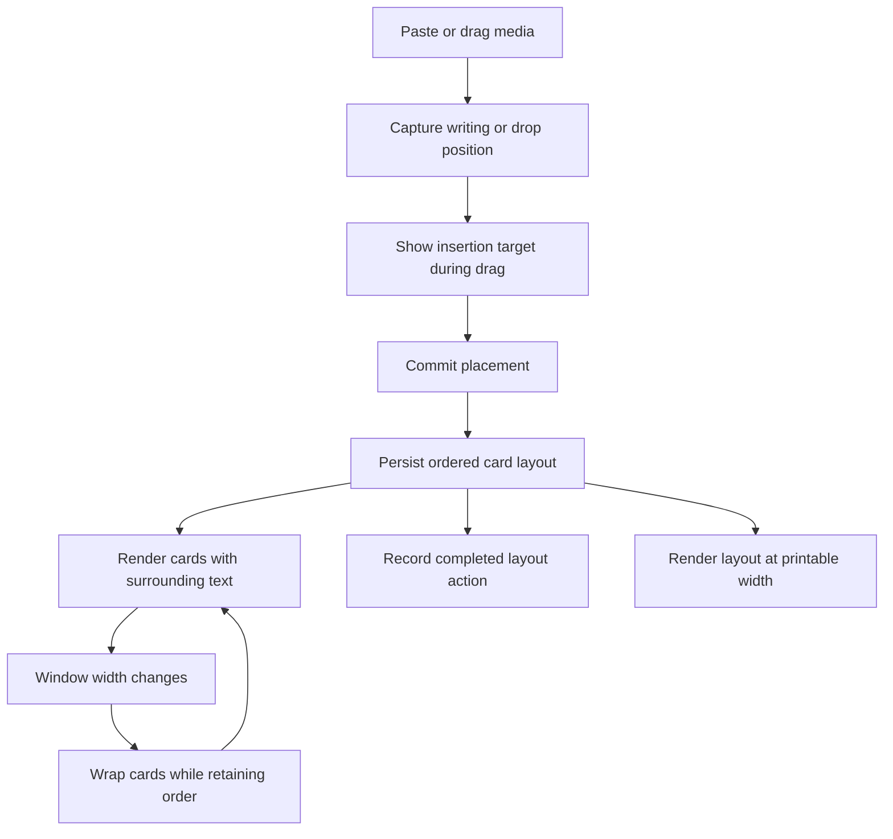

# Specification: Media card layout in notes

- **Specification ID**: 013
- **Date**: 2026-10-18
- **Slug**: media-card-layout
- **Status**: Implemented
- **Owner**: Note media layout bounded context
- **Related Specification**: [003 — Native Mac paper refresh](003-2026-10-04-native-mac-paper-refresh.md), [008 — Pipelines](008-2026-10-07-pipelines.md), [012 — Attached sidebar and daily home](012-2026-10-15-attached-sidebar-and-daily-home.md)

---

## Context & Background

The user wants to place media cards beside one another and write beside cards in the note editor. The decisions below were confirmed over three grilling rounds on 2026-10-18, followed by an explicit request to generate this specification.

Existing cards represent links, local images and attached PDFs. Their SQLite layout consists of `side`, `anchor` and `width`; snapshot order follows creation order. There is no persisted card group or explicit card-relative order. The renderer selects a side using the editor midpoint and a text anchor using the pointer's vertical position.

The CSS rule `.paper-cut.cut-left,.paper-cut.cut-right{clear:both}` prevents adjacent cards. Cards wider than 65% additionally receive `float:none`. Paste and external drop do not pass caret or pointer placement to import handlers. Page history excludes card layout. PDF export emits separate figures and ignores the chosen side.

This specification concerns media in the ordinary note page. It does not extend the home daily editor or pipeline task editors, whose media boundaries are described in specifications 012 and 008. An ordinary daily note opened through the note page uses the note page behavior.

---

## Problem Statement

### 1. Available horizontal space cannot be used for adjacent cards

Dragging chooses a side and text anchor, but every card clears previous floats. A visually narrow card therefore prevents another card from sharing its row. There is no preview of a card-relative drop destination.

### 2. Insertion does not follow the user's editing position

Pasting and dropping media create cards with default placement instead of the captured writing or drop position.

### 3. History and export do not represent the requested layout

Moving or resizing a card cannot be undone through page history. Exported PDFs lose the chosen arrangement by stacking figures independently of their editor layout.

---

## Solution

### Confirmed behavior

1. Link, image and PDF cards share the same positioning and sizing behavior.
2. Dragging beside another card supports placement in the same row. A visible insertion indicator shows whether the card will be placed before, after or beside the target.
3. Cards divide the available group space equally when joined side by side. Their widths can be adjusted afterward.
4. Text wraps beside the card or card group when space remains and continues below it. Text is not placed in a separate independent column.
5. When the window becomes too narrow, cards wrap to subsequent rows while preserving order. Widening the window restores the side-by-side arrangement when space permits.
6. Paste inserts at the writing position. External drag and drop insert at the drop position, using the same placement indicator.
7. Each completed move or size adjustment is one undoable page-history action. Redo restores it through the existing history workflow.
8. PDF export preserves card order, adjacent placement and surrounding text flow, adapting to the printable page width.

---

## Practical Gains & Operational Outcomes

1. **Composition**: cards can share horizontal space, and writing can continue alongside and below them.
2. **Predictable insertion**: paste and drop use the user's selected destination rather than a default location.
3. **Recoverability**: a completed layout change can be undone without manually reconstructing the previous arrangement.
4. **Consistent export**: PDF output follows the saved composition within the printable width.

---

## User Stories

- [x] 1. As a writer, I can drag a card beside another card to arrange references together.
- [x] 2. As a writer, I can see the insertion destination before releasing a dragged card.
- [x] 3. As a writer, I can position cards before or after existing content.
- [x] 4. As a writer, I get equal card widths when joining cards in a row and can adjust widths afterward.
- [x] 5. As a writer, I can write in the space beside a card or group and continue below it.
- [x] 6. As a writer, I get the same behavior for links, images and PDFs.
- [x] 7. As a writer, I can narrow and widen the window without losing card order or the intended arrangement.
- [x] 8. As a writer, I can paste media at my writing position.
- [x] 9. As a writer, I can drop media at the indicated destination.
- [x] 10. As a writer, I can undo and redo each completed card move or size adjustment.
- [x] 11. As a writer, I can export the composition to PDF with width-appropriate wrapping.

---

## Architecture Gate

The following defines responsibility boundaries. The execution definitions below complete the storage, wire types and public test seams before the first failing test.

### 1. Bounded Context & Ubiquitous Language

- **Context**: Note media layout.
- **Card**: an existing link, image or PDF cut identified by its existing cut ID.
- **Placement**: the saved relationship between a card, surrounding writing and other cards.
- **Card group**: cards intentionally arranged beside one another, with a saved order and adjustable widths.
- **Insertion target**: the writing position or card-relative destination selected by a gesture.
- **Reflow**: width-dependent wrapping that preserves saved order and permits restoration at wider widths.
- **Layout action**: one completed move or size adjustment, represented by a single page-history step.

#### Package ownership map

| Package or integration point | Primary responsibility |
| :--- | :--- |
| `src/shared/media-layout/domain/` | Pure layout aggregate, placement and width invariants and responsive projection; the application receives the domain persistence port |
| `src/main/media-layout/application/` | One use case per module for reading, moving, resizing and restoring layout |
| `src/main/media-layout/infrastructure/` | SQLite layout persistence and transaction adapter |
| `src/main/media-layout/presentation/` | Purpose-specific Electron IPC payload validation and result mapping |
| `src/main/media-layout/compose.cjs` | Composition of the context and its adapters |
| `src/renderer/media-layout/` | Note-page pointer interactions, insertion indicator, layout rendering and history integration |
| Existing media import application boundary | Import content and apply its captured insertion destination through the layout use case |
| Existing PDF export boundary | Consume saved layout and render it at printable width |

Public application modules are `read-layout.cjs`, `move-card.cjs`, `resize-card.cjs` and `restore-layout.cjs`; `compose.cjs` exposes `read`, `move`, `resize` and `restore`. The domain API exposes placement validation, grouping, mutation and responsive projection. `sqlite-layout-repository.cjs` owns persistence and `ipc.cjs` owns channel validation. Existing `cuts.js`, `undo.js`, `block-editor.js`, main composition and PDF export are integration points, not owners of new domain rules. Any shared layout projection must be pure and explicitly owned by this context; `src/shared/` must not become an ownerless collection of feature rules.

### 2. Aggregate Root & State Transitions

- **Aggregate root**: `NoteMediaLayout`, identified by the owning note ID. It owns the layout relationships of that note's cards, not media bytes, fetched metadata or note text.
- **Durable transition**: saved layout → move or resize → saved layout; undo and redo restore the corresponding previous or next layout.
- **Presentation transition**: idle → dragging with insertion preview → commit or cancel → idle. Cancel removes the preview without persisting a completed layout action.
- **Invariants**: cards belong to the same owning note; each placed card has one placement; order is deterministic; width changes cannot overlap cards or cause horizontal clipping; reflow retains logical order; metadata completion cannot reset layout or the writing selection; successful writes are reported only after commit.

### 3. Commands, Queries & Domain Ports

Required application operations are read layout, place an existing card, resize a card, apply an insertion destination to imported media, and restore layout for undo/redo. Semantic domain events are card placed, card resized and layout restored; these do not require a new broadcast channel.

The domain persistence port reads layout with its owning card references and commits a validated layout change atomically. Infrastructure implements it using SQLite. The domain imports no Electron, SQLite, filesystem or DOM APIs. Application code depends on domain ports; infrastructure and presentation depend inward.

### 4. IPC Contract & External Input Validation

The current affected contracts are:

| Existing channel / action | Current preload surface | Required change |
| :--- | :--- | :--- |
| `notebook:action` / `cut:layout` | `action(action, input)` | Replace the affected layout operation with purpose-specific layout capability calls; do not add generic IPC exposure |
| `cuts:image` | `image(input)` | Carry the captured insertion destination alongside existing file input |
| `cuts:pdf` | `pdf(input)` | Carry the captured insertion destination alongside existing file input |
| `cuts:link` | `link(input)` | Carry the captured insertion destination alongside existing URL input |
| `notebook:state` and media update snapshot | Existing state and media update functions | Represent saved card grouping, order and widths without letting metadata updates overwrite placement |
| `notebook:export-pdf` | `exportPDF(id)` | Consume the saved layout; no new export input is required |

Exact channels, payloads, limits and errors are recorded in the execution definitions below. Main-process validation must reject malformed identifiers, invalid numeric values, invalid destinations, foreign-note references and changes to trashed content before invoking a use case. Persistence must not accept raw renderer geometry as trusted domain state.

---

## Implementation Decisions

1. A CSS-only removal of `clear:both` is insufficient: persisted order, insertion targeting, history and PDF composition are part of the confirmed scope.
2. Responsive reflow must not overwrite the intended saved arrangement; otherwise widening cannot restore it.
3. Geometry and the visual indicator belong to presentation. Group membership, order and persisted width invariants belong to the domain/application boundary.
4. Multi-card changes and history restoration must commit atomically. No legacy adapters, dual layout models or temporary compatibility paths are permitted.
5. Retain the existing media identity and content boundaries. This work does not change link fetching, local blob storage or PDF attachment extraction requirements.
6. Keep files focused on one responsibility, targeting 250 lines or fewer. No file may exceed 350 lines without a concrete approved exception recorded here.

### Execution definitions confirmed on 2026-10-18

The user accepted Q9–Q12 and authorized the technical contracts and public test seams below.

- Minimum rendered card width: 180 CSS px, or the available content width when narrower. Minimum adjacent text width: 220 px. Spacing: 18 px. Groups may occupy the full content width. Responsive projection never changes persisted widths.
- Paste anchors beside the containing paragraph without splitting its runs. For tables, code and diagrams, anchor before the block. The media dialog captures the previous writing position before taking focus.
- History restoration ignores removed/trashed cards and does not restore their content. Live cards absent from a historical layout retain their current placement. When needed, historical widths fit proportionally into their remaining group capacity; incompatible historical anchors/sides use a distinct group identity, and retained cards reserve their live ordinal slots.
- Storage adds `layout_group` and `layout_order` to cuts. Existing cards migrate to singleton groups identified by their card ID, preserving side, anchor and width. New imports initialize placement in their creation transaction. Same-group cards share anchor and side and use contiguous zero-based order. Width is an editor-width fraction greater than zero and at most 1; the group sum cannot exceed 1. Joining distributes the group's space equally, capped at 1. Resizing is clamped to the remaining group capacity. Pixel minimums are applied in responsive presentation, not persisted as device-dependent values.
- The pure feature domain lives in `src/shared/media-layout/domain/` so both presentation and export can use its projection without duplicating invariants. Main application/infrastructure/presentation remain in the context packages above.
- `Placement = { kind: 'block', anchor: integer 0..10000, side: 'left'|'right' } | { kind: 'card', cutId: identifier, edge: 'before'|'after'|'beside-before'|'beside-after' }`.
- `SavedPlacement = { id, groupId, position, anchor, side, width }`; identifiers are strings matching `[A-Za-z0-9_-]{1,128}`, position is an integer 0..99, and there are at most 100 cards per note.
- Purpose-specific channels/preload functions: `media-layout:read` / `mediaLayoutRead({noteId})` → `SavedPlacement[]`; `media-layout:move` / `mediaLayoutMove({noteId,cutId,target:Placement})`; `media-layout:resize` / `mediaLayoutResize({noteId,cutId,width})`; `media-layout:restore` / `mediaLayoutRestore({noteId,placements:SavedPlacement[]})`. Mutations return the current notebook snapshot. `cut:layout` is removed from the generic action contract and callers are updated directly.
- Import channels accept optional `placement:Placement`; omission retains default right-side insertion at anchor 0 for existing non-interactive callers. This is one import path with an optional destination, not a legacy layout adapter. Import validation occurs before storing bytes or starting asynchronous work.
- Note snapshots expose group ID and order on each card, alongside existing anchor/side/width. Metadata notifications merge metadata only, preserving current layout.
- Validation errors use readable Portuguese messages: `Posição do recorte inválida.`, `Largura do recorte inválida.`, `Recorte não encontrado.`, `Nota não encontrada.`, and `Restaure o recorte antes de mover.` Missing historical IDs are ignored only by restore; foreign-note IDs are rejected.
- The SQLite repository port owns read/mutate transactions and note timestamps; move, resize and restore each have their own application module. The renderer serializes layout/history mutations with pending edit saves and flushes them before quit.
- PDF layout uses the same group order and width projection, with print CSS wrapping and card break avoidance. Oversized content may paginate rather than be clipped.
- Public verification seams: domain layout/projection API, composed application API with a real temporary SQLite store, IPC registration through an injected Electron handler boundary, committed Electron smoke tests and PDF HTML/print output.
- Existing composition modules `main.cjs`, `store.cjs`, `renderer.js`, and editor integration `block-editor.js`, are above 250 lines. Their owner remains main composition/store/editor respectively; this task only adds focused calls and removes superseded layout handling. They must remain below 350 lines. The existing external smoke dispatcher `tests/smoke/run.cjs` is a concrete exception to the 350-line ceiling: owner is the Electron test harness; it was already 359 lines and is 366 after adding the scoped dispatch. Scenarios and verification live in separate new test modules. No production file exceeds 350 lines.

---

## Testing Decisions

Use existing behavioral seams: the SQLite/store integration tests, Electron media/undo smoke scenarios, and PDF export tests. Tests must assert observable placement and persistence rather than private helper structure. New context tests supplement those seams for pure invariants and IPC rejection. The user confirmed these verification boundaries in Q12. Execution evidence is recorded below.

| Layer | Required evidence |
| :--- | :--- |
| Domain | Deterministic grouping/order; equal sizing when joining; valid subsequent resize; invalid placement/width rejection; reflow preserves intended layout |
| Application | Each command invokes the appropriate domain operation and persistence port; multi-card actions are atomic; failed writes do not produce successful history actions |
| Infrastructure | Reopen retains group/order/width; explicit migration; transaction rollback preserves prior layout; foreign-note and trashed-card writes are rejected |
| Main presentation / IPC | Request validation, purpose-specific preload contracts, snapshot shape, readable errors and unchanged state after rejection |
| Renderer presentation | Insertion target and indicator; before/after/beside drops; equal initial division; width adjustment; text beside and below; responsive wrap and restoration |
| History integration | One step per completed gesture; interleaved text/layout undo and redo; cancellation/no-op does not create a false edit; acknowledged save failure is surfaced |
| Import integration | Paste captures writing position; external drop captures indicated destination; asynchronous PDF import and link metadata do not move the target or overwrite later layout |
| PDF export | Card order/grouping and text wrapping follow saved layout at printable width; narrow-page reflow; pagination preserves content; escaping and local media embedding regressions |

### Unit & Profile Tests

Pure layout tests cover the numeric and ordering invariants in the execution definitions. Do not introduce performance infrastructure or benchmarks without a demonstrated need.

### Integration & Contract Tests

Extend existing store/media tests and add focused layout-context tests. Use temporary data directories exclusively. Verify rollback and reopening as well as successful mutations.

### Error Safety & UI Tests

Committed Electron smoke tests may assert behavior and layout geometry. Run them sequentially. Manual screen validation belongs to the user in the running app; no automated browser or ad hoc DOM inspection may substitute for it. Pointer cancellation and note navigation must remove the insertion indicator and release gesture listeners.

### Regression Tests

Retain coverage for writing/formatting/selection, metadata updates, source actions attached to media, opening retained images/PDFs/links, trash and restoration, daily editor boundaries and task editor isolation.

---

## Acceptance Criteria

- [x] 1. The unresolved definitions are settled and the architecture gate, migration and IPC types are complete before test or implementation code changes.
- [x] 2. Links, images and PDF cards can be arranged side by side with a visible drag destination.
- [x] 3. Joined cards initially divide their space equally and permit subsequent width adjustment.
- [x] 4. Text flows beside cards or groups when space permits and continues below them.
- [x] 5. Narrowing wraps cards in order; widening restores the intended adjacent arrangement.
- [x] 6. Paste and external drop use their captured writing/drop destination.
- [x] 7. Each completed move or resize supports one-step undo and redo alongside ordinary text edits.
- [x] 8. Saved composition survives reopening and is not overwritten by metadata completion.
- [x] 9. PDF export preserves the composition with width-appropriate wrapping and without lost content.
- [x] 10. All relevant unit/integration tests pass on Node 22+, and every changed `.js`/`.cjs` file passes `node --check`.
- [x] 11. Affected media, editor, undo and PDF Electron smoke tests pass sequentially with isolated test data.
- [ ] 12. The user verifies the visual layout in the running app and exported PDF.
- [x] 13. Architecture review confirms single responsibility, inward dependencies and all external integrations behind domain ports.
- [x] 14. The implementation report and mandatory formal reviewer diagnosis/table are delivered; the status becomes `Waiting Approve` only after required verification passes.

---

## Out of Scope

- Free-position canvas, overlapping cards or arbitrary text boxes.
- Independent text columns.
- Adding media-card support to the home daily editor, task descriptions or task comments.
- Changing preview retrieval, attachment limits or media content semantics.
- Adding media insertion, deletion or trash operations to history beyond the agreed move/resize scope.
- Unrequested commits, pushes, release publication or automatic specification approval.

---

## Further Notes

- Behavior decisions and execution definitions were confirmed in the recorded conversation before implementation.
- Follow sequential Red-Green-Refactor after the architecture gate is complete, on a dedicated task branch. Do not change implementation before its failing test.
- Implementation evidence follows. Manual visual validation and explicit user approval remain separate from automated checks.
- README reviewed: no change needed. Existing product descriptions and screenshots remain descriptions of the current app; this unimplemented specification is not advertised as delivered functionality. The current README has no specifications index.
- Historical implemented specifications remain unchanged. This specification supersedes their media layout/history/export descriptions only for the behavior explicitly covered here.

### Implementation record — 2026-10-18

- Branch: `codex/013-media-card-layout`. No commit or push performed.
- Added the pure layout domain and main application, SQLite adapter and IPC boundary. Migration keeps existing card anchors, sides, widths and same-anchor creation order.
- Replaced generic `cut:layout` callers with purpose-specific commands. Group changes and imported placement commit atomically; foreign targets, malformed inputs and anchor overflow are rejected.
- Added grouped rendering, responsive wrapping, insertion indicators, pointer cleanup and per-action layout history. Metadata completion updates preview fields only. ResizeObserver notifications schedule width-dependent changes in an animation frame; disposal cancels that frame and disconnects the observer.
- Serialized pending note mutations and delayed native window close until queued work finishes. Layout/import acknowledgements update cards without replacing active writing, including the invalid-image error path.
- PDF export consumes the saved grouping/order and shared width projection. A PDFKit test reader checks all pages rather than using the production attachment reader, which intentionally returns only an excerpt.
- Updated development/user documentation and screenshot tooling for the new public layout contract.
- No scope change from the confirmed decisions. The initial text-ordering P1 was corrected after authorization; the subsequently identified restore/import conflicts were corrected under the approved retention rule and delegated allocation decision. History completion is backed by application, renderer and Electron regressions. The documented test-dispatcher size exception is the only file-size exception. Visual fidelity still requires the user's running-app and PDF check.

#### Files created or changed

- `docs/DEVELOPMENT.md`, `docs/USER_GUIDE.md`
- `scripts/capture-readme.cjs`
- `src/main/main.cjs`, `src/main/pdf-export.cjs`, `src/main/preload.cjs`, `src/main/store.cjs`
- `src/main/media-layout/application/initialize-import.cjs`, `src/main/media-layout/application/move-card.cjs`, `src/main/media-layout/application/read-layout.cjs`, `src/main/media-layout/application/resize-card.cjs`, `src/main/media-layout/application/restore-layout.cjs`
- `src/main/media-layout/compose.cjs`
- `src/main/media-layout/infrastructure/sqlite-layout-repository.cjs`
- `src/main/media-layout/presentation/ipc.cjs`, `src/main/media-layout/presentation/pdf-layout.cjs`
- `src/renderer/block-editor.js`, `src/renderer/cuts.js`, `src/renderer/edit-history.js`, `src/renderer/index.html`, `src/renderer/notes-index.js`, `src/renderer/renderer.js`, `src/renderer/undo.js`
- `src/renderer/media-layout/drag.js`, `src/renderer/media-layout/layout.css`, `src/renderer/media-layout/mutations.js`, `src/renderer/media-layout/render.js`
- `src/shared/media-layout/domain/layout.js`
- `tests/cuts-smoke.js`, `tests/edit-history.test.cjs`, `tests/helpers/renderer-history.cjs`, `tests/renderer-history.test.cjs`, `tests/media-layout-ipc.test.cjs`, `tests/media-layout-smoke.js`, `tests/media-layout.test.cjs`, `tests/media.test.cjs`, `tests/pdf-cuts-smoke.js`, `tests/pdf-export.test.cjs`, `tests/store.test.cjs`
- `tests/smoke/media-layout.cjs`, `tests/smoke/pdf-full-text.swift`, `tests/smoke/run.cjs`

#### Verification evidence

- Sequential Red/Green cycles: grouped persistence; resize limits/rollback; history restoration after removal; responsive projection; atomic import placement; IPC validation; layout history interleaved with typing; adjacent-card Electron geometry; drag and resize history; paste/drop placement; PDF grouping; detaching the original group card; migration order; removal of the old command; anchor overflow; import target validation; observer cleanup; writing during successful/failed asynchronous operations; queued layout undo followed by typing; and ResizeObserver feedback reported by the complete Electron suite.
- `npm test`: 284 passing tests on Node 22.23.1.
- `npm run test:app`: complete Electron suite passed, including native input, selection, editor, media, source actions, home, calendar, categories and undo.
- Scoped Electron runs passed: `--media-layout-only`, `--pdf-cuts-only`, `--pdf-only`, `--pipelines-only`. Layout checks include real PDF generation/full text extraction, delayed-save close flushing, resource disposal and typing while layout/import work is pending. Expected rejection scenarios log their injected errors.
- `node --check`: every changed/new JavaScript file; `git diff --check`: no whitespace errors.
- `npm run package`: generated the macOS arm64 app; isolated packaged-entry startup exercised the layout preload/IPC/domain path with `app.isPackaged === true`. The external bootstrap used temporary test data and restored the archive after verification. The packager emitted its existing icon-format warning.
- README review: reviewed, no change needed; there is no current specifications index and no delivered-layout claim was added.
- Manual visual validation remains outstanding. Automated geometry assertions above belong to committed smoke tests, not ad hoc DOM inspection.

### Formal code reviewer diagnosis — initial P1 (corrected after authorization)

**P1: text typed after Undo can be overwritten when an earlier text save is pending.** `src/renderer/undo.js:57` awaits the current note mutation queue before reading history and scheduling the restore. `src/renderer/renderer.js:26` independently admits later text updates to that queue. A later keystroke can therefore be saved before the older undo operation is finally enqueued at `undo.js:90`; that restore then overwrites both the visible writing and the later saved text. This affects ordinary notes through the changed generic save path, even without media.

A read-only, isolated Node VM probe executed the actual `edit-history.js`, `media-layout/mutations.js`, `undo.js` and extracted `action`/`performAction` functions. Browser effects were presentation stubs, and the persistence boundary was an in-memory adapter with a controlled pending response; no real app data or rendered HTML was inspected. Starting from `base`, the probe requested a save of `base first`, requested undo while that save was pending, and submitted `base first after` before releasing the response. The observed write order was `base first` → `base first after` → `base`; the final displayed and adapter-persisted value was `base`. Thus `after`, typed after requesting Undo, was lost. The existing committed suites pass but do not cover this delayed-text-save ordering; the layout-only stress case is distinct.

| CURRENT IMPLEMENTATION | PROBLEM | IMPROVEMENT (GAIN) |
| :--- | :--- | :--- |
| Undo awaits the current queue and only later schedules its restore; subsequent typing joins the queue independently. | Confirmed P1 ordering defect: the delayed restore can overwrite post-Undo typing in ordinary notes. | Reserve the undo operation's ordering and history intent when requested, before subsequent edits; first add and run a failing regression with a deferred save response. This preserves later writing without adding channels or workers. |

The user authorized the correction below. Six committed delayed-operation regressions now pass, including the original write-order failure; the real Electron/SQLite scenario also passes. The initial P1 is resolved. History completion remains open because the subsequent audit found a distinct import/restore conflict.

### Authorized correction — 2026-10-18

The user explicitly authorized correcting the open P1 after the formal review. The bounded context, IPC contracts and public testing seams remain unchanged.

- Local history records text edit intent when the editor requests a save. Undo/redo captures and applies its history intent immediately and reserves persistence in the existing mutation queue before later edits can join it.
- A history step compares its requested before/after snapshots, not an older acknowledged note snapshot, to determine which fields must be persisted. A late acknowledgement updates acknowledged state without replacing newer writing or intent.
- Layout intent uses the already shared pure domain for local projection; main-process validation and SQLite commit remain authoritative. Acknowledgements reconcile the corresponding layout snapshots without creating or reordering history steps. A rejected layout removes the unsuccessful projected transition while preserving subsequent text edits.
- Queue ownership tracks pending mutations per note so rendering does not mistake locally pending history for an external edit. Import acknowledgement updates its captured layout baseline without overwriting subsequent local layout intent.
- Test ownership: `tests/helpers/renderer-history.cjs` adapts the real ordered renderer commands to controlled presentation/persistence ports; `tests/renderer-history.test.cjs` owns delayed-operation regressions.
- Regression matrix at the agreed save/history boundary: deferred text save → Undo → subsequent typing; rapid undo/redo while saves are pending; pending layout → Undo → typing; rejected layout followed by typing. Assert the final value through the persistence adapter as well as the presentation port. Committed Electron smoke tests verify the real editor and isolated SQLite path.

### Subsequent formal review — P2 corrected after authorization

**P2: Undo rejects a historical width after importing another card into the same group.** A read-only review probe used the actual `Store`, composed layout application and `EditHistory` with a temporary database under ignored artifacts. Card A starts at 0.8; resizing to 0.6 creates history; importing B beside A produces 0.5/0.5. Undo requests historical A=0.8 while B, absent from that historical snapshot, retains 0.5. `domain/layout.js:64` rejects the 1.3 total. SQLite remains unchanged, but the promised completed resize cannot be undone. This is an active import/history path, not a speculative future use.

| CURRENT IMPLEMENTATION | PROBLEM | IMPROVEMENT (GAIN) |
| :--- | :--- | :--- |
| Restore overlays historical cards and retains newer live cards, then rejects group sums above 1. | Confirmed 0.8 + 0.5 conflict rejects Undo after a beside-card import. The individually approved retention and width rules conflict in this case. | Obtain an explicit reconciliation rule, then add a failing application/history regression before correction. Proposed rule: retain the new card placement and clamp the historical width to the remaining group capacity. This permits undo without removing imported content. |

The reviewer also examined queue ordering, failure reconciliation, per-note pending cleanup, listener/observer/frame disposal, IPC validation and ownership, transaction rollback, main/renderer boundaries, escaping, close flushing and packaged resource resolution; no other actionable violation was confirmed. Production files remain below 350 lines and the existing dispatcher exception remains applicable. No source correction was applied during that review. At that point story 10 and criteria 7/14 remained open and status was `In Progress`. The user subsequently approved the correction and delegated the allocation decision, as recorded below.

### Authorized restore-width correction — 2026-10-18

The user approved preserving newly imported live cards and clamping historical widths to the remaining group capacity during restore. The existing NoteMediaLayout aggregate, application use case, SQLite repository, IPC and package ownership remain unchanged. The regression uses the already agreed composed application/history boundary with isolated SQLite. Required evidence: A=0.8 → resize to 0.6 → import B beside A → Undo retains B and fits A into the remaining 0.5, without mutating B or rejecting the restore. The user delegated the allocation decision. Historical cards are reduced proportionally only when their valid historical widths exceed the capacity left by newer cards; their relative width ratios are preserved. Newer cards keep their live width and placement. Historical-only invalid groups remain rejected. Undo/redo acknowledgement reconciles the effective saved widths into history and the displayed cards while preserving subsequent writing or layout intent. Tests cover one and multiple historical cards, unchanged newer cards, invalid payload rollback, renderer history and real Electron persistence.

The delegated reconciliation decision also preserves imported anchors/sides when restoring an earlier card move: if historical and newer cards would share a group identity at incompatible anchors/sides, restored historical members receive a distinct group identity. Newer members keep their live group, anchor, side and width; ordinals compact when a group loses members. This directly implements historical restoration plus the approved retention rule without moving newly imported content. The composed application regression covers the reproduced rejection.

Retained cards reserve their live ordinal slots within a restored group; historical members fill the other slots in historical order. Slots compact only when members leave the group, keeping ordinals contiguous. An application regression covers two newer cards inserted before two historical members, preserving both newer placements.

Undo/redo projects the same pure restore policy immediately against live cards before reserving persistence. The main process still validates and commits the request; acknowledgement reconciles canonical saved placements without replacing later intent. A deferred-restore regression verifies that the imported card remains editable while Undo is awaiting acknowledgement.

### Final implementation report and formal review — 2026-10-18

Restore/import correction files: `src/shared/media-layout/domain/layout.js`, `src/renderer/undo.js`, `tests/media-layout.test.cjs`, `tests/renderer-history.test.cjs`, `tests/helpers/renderer-history.cjs`, `tests/media-layout-smoke.js`, this specification and `docs/USER_GUIDE.md`. Four application regressions cover width clamping, proportional allocation/invalid-write rollback, anchor separation and retained insertion order. Two renderer regressions cover canonical display/history and editing while restore acknowledgement is pending. The Electron scenario verifies effective widths, imported placement, rendered equality and subsequent text undo against saved state. Each corrective source slice followed a failing regression. Delegated reconciliation decisions above are the only refinements; no IPC/schema changes were added.

Final checks passed: 284 unit/integration tests; complete Electron suite; scoped media-layout suite including PDF/full-text and close flushing; syntax checks for all 37 changed/new JavaScript files; whitespace check; macOS arm64 packaging; isolated startup through the real packaged executable. Existing earlier PDF and pipeline verification remains recorded above. README reviewed, no change needed. The packager's existing icon-format warning persists. No commits or pushes; manual app/PDF visual validation is outstanding.

The explicit reviewer stance followed the implementation report before this audit. The audit examined pure restore invariants, malformed historical widths/ownership rejection, transaction rollback, retained ordering/anchors, identifier collisions, local projection and late acknowledgements, queue/close ordering, dependency direction and resource lifetime. An additional read-only probe checked 42 valid historical/import width/order/anchor combinations for input immutability, retained placements, proportional capacity, deterministic repeat restoration and independent anchor groups. No new listeners, workers, filesystem/network capabilities or IPC channels were added by the correction. Every changed production module retains one responsibility and inward dependencies; no new architecture exception was needed. No corrective source changes were applied during review.

| CURRENT IMPLEMENTATION | PROBLEM | IMPROVEMENT (GAIN) |
| :--- | :--- | :--- |
| Proportional restore, retained slots/anchors, immediate local projection and canonical acknowledgement reconciliation. | No actionable defects or boundary violations found after rigorous audit. | No corrective change proposed. |

Automated acceptance evidence and the formal report/review are complete. The user explicitly approved the specification and requested completion of the build/version/tag release on 2026-10-18. Status transitioned from `Waiting Approve` to `Implemented` with that authorization. Manual visual validation was not separately reported and its evidence checkbox remains unchecked. This specification is now a historical record.
