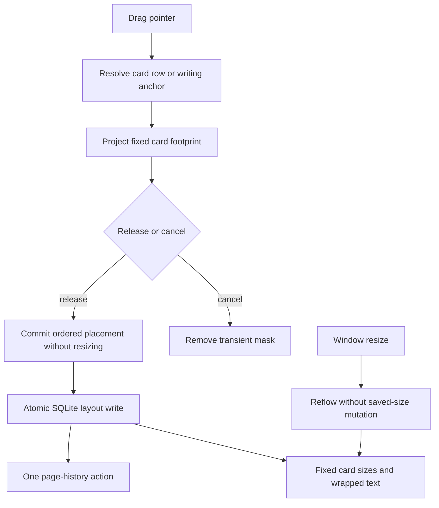

# Specification: Fixed-size media cards and destination masks

- **Specification ID**: 014
- **Date**: 2026-10-19
- **Slug**: fixed-media-cards
- **Status**: Implemented
- **Owner**: Note media layout bounded context
- **Related Specification**: [013 — Media card layout](013-2026-10-18-media-card-layout.md)

## Context & Background

The user reported that cards expand with the notebook window, adjacent empty-space drops create full rows, and the insertion indicator is a rule rather than a card mask. The user instructed the agent to resolve these issues after receiving the recommendations below. This specification supersedes specification 013's fractional sizing, equal division on joining, group width capacity and proportional restore policies. Specification 013 remains unchanged as a historical record.

## Problem Statement

1. Width is stored as a fraction and projected against the current editor width, so window resizing stretches cards and their images.
2. Only points inside another card select a card-relative destination. Empty adjacent space selects a block destination and creates a separate group that clears the row.
3. The insertion indicator has a three-pixel dimension and cannot communicate the future card footprint or wrapping.

## Solution

- New and existing cards start at a saved width of 240 CSS px. Manual minus/plus controls change width by 40 px, clamped to 180–600 px. Only explicit size controls change saved width.
- Moving, joining, importing beside another card, undo/redo and resizing the window preserve individual saved widths. Groups wrap with an 18 px gap. Writing continues alongside when at least 220 px remains, and below otherwise.
- When the content viewport itself is narrower than one card, its displayed width is capped to the viewport without changing its saved width. Images preserve their aspect ratio. Widening restores the saved width.
- During internal dragging and external media dragging, show a translucent, bordered card-shaped destination mask. Existing cards use their displayed height; external media with unknown dimensions use a 180 px mask height. The mask uses the incoming card's fixed width, capped to the content viewport, never the writing row's width.
- Empty space in an existing card row is a valid beside target, including the space outside the current group and gaps between cards. Pointer position chooses the nearest card edge. Inside-card top/bottom zones retain before/after placement. Group packing projects the prospective slot and line break for the destination mask.
- Preview is transient presentation state; dropping commits one layout action. Escape, pointer cancellation, leaving the editor and navigation clear it and dispose gesture listeners. Repeated pointer updates do not create history entries.
- PDF uses the same saved pixel widths and wrapping policy at printable width; no percentage-based stretching remains.

## Practical Gains & Operational Outcomes

Cards keep their scale while the notebook window changes. The destination mask communicates a card-sized slot and adjacent drops work in the visible free space. Saved layout, undo/redo and PDF share one fixed-width model.

## User Stories

- [x] 1. Window resizing never enlarges my media cards.
- [x] 2. Manual width controls are the only way to change an existing card's saved width.
- [x] 3. Joining cards preserves their individual sizes and wraps them when needed.
- [x] 4. Dragging beside a card targets its row even when the pointer is in empty space.
- [x] 5. A card-shaped mask previews the destination, including line wrapping.
- [x] 6. Canceling a drag leaves no mask, listeners, saved change or history entry.
- [x] 7. Undo/redo preserves sizes and subsequent writing while saves are pending.
- [x] 8. PDF output uses fixed widths and retains all writing.

## Architecture Gate

### Bounded context, language and ownership

The existing NoteMediaLayout aggregate owns card identifiers, group membership, order, anchors, sides and explicit pixel widths. A row is the visual packing of members of one group at the current content width. A mask is a transient presentation rectangle for the proposed incoming card. Responsive projection is a query, never a durable size transition.

| Package / public module | Primary responsibility |
| :--- | :--- |
| `src/shared/media-layout/domain/layout.js` | Pure placement, fixed width validation, history restoration and responsive projection |
| `src/main/media-layout/application/` | Existing read/move/resize/restore/import use cases through the persistence port |
| `src/main/media-layout/infrastructure/sqlite-layout-repository.cjs` | Explicit width migration and atomic layout persistence |
| `src/main/media-layout/presentation/` | Existing validated IPC registration and PDF layout adapter |
| `src/renderer/media-layout/render.js` | DOM groups, fixed-size rendering and observer disposal |
| `src/renderer/media-layout/targets.js` | Card-row hit testing and destination-mask geometry; presentation only |
| `src/renderer/media-layout/drag.js` | Pointer gesture lifecycle and mask DOM lifecycle |
| `src/renderer/cuts.js` | Existing card controls and media import/drop integration |
| `src/renderer/undo.js`, `edit-history.js`, `media-layout/mutations.js` | Existing intent queue, snapshot projection and canonical acknowledgement reconciliation |
| `tests/fixed-media-cards.test.cjs` | Public pure domain and composed application regressions with isolated SQLite |
| `tests/fixed-media-cards-smoke.js` | Real Electron gestures, fixed geometry, writing flow, masks and saved state |
| Existing history / PDF / media test modules | Update obsolete fractional expectations and retain their behavioral coverage |

Dependencies point inward: presentation and infrastructure use application/domain; the pure domain imports no DOM, Node or Electron APIs. No new external integration is introduced. Existing main/store composition and renderer integration remain below 350 lines; their previously documented 250-line evaluation remains applicable. The existing smoke-dispatcher size exception from 013 remains owned by the external Electron harness: `tests/smoke/run.cjs` grows from 366 to 373 lines to dispatch the new scenario and check its PDF text.

### State transitions, commands, queries and ports

Durable state is changed only by existing import/move/resize/restore commands. Moving preserves widths; resizing validates an integer CSS-pixel width; restoring ignores removed cards, keeps newer live placements and restores historical widths exactly. Existing separation of incompatible historical anchors/sides and retained ordinal slots remains. Group sum is unrestricted because presentation wraps cards instead of shrinking them.

Gesture transitions: idle → dragging with destination mask → commit or cancel → idle. Window resizing only reprojects current state. Application use cases retain the existing repository `read`, `initialize`, `assertOwnership` and atomic `mutate` port. Existing semantic placement/resizing/restoration events need no new broadcast.

### IPC and storage contracts

Existing channels/preload names remain: `media-layout:read` / `mediaLayoutRead`, `media-layout:move` / `mediaLayoutMove`, `media-layout:resize` / `mediaLayoutResize`, `media-layout:restore` / `mediaLayoutRestore`. The `width` field in saved placements, note snapshots, resize requests and restore requests is now an integer CSS-pixel width in 180..600. Fractional, string, nonfinite and out-of-range widths are rejected with the existing readable error. Identifier, ownership, maximum 100 cards, anchor, side and order validation remain unchanged. Import payloads still carry `placement`; new cards use 240 px.

SQLite keeps one `width` column, changes its type/default to `INTEGER NOT NULL DEFAULT 240`, and resets existing card widths to 240 in an explicit atomic migration. Other card data, references, media, groups, order, anchors and sides remain intact. Migration uses add/drop/rename column operations without rebuilding card identity or foreign-key references. The column type/default identifies completion; reopening does not reset explicit pixel widths. No dual units, legacy adapters or percentage fallback remain.

## Implementation Decisions

The user authorized resolving the recommendations; remaining numeric choices are 40 px manual steps and 180..600 px bounds. Mask styling uses existing ink/accent tokens and is noninteractive. Hit testing and footprint calculations belong to presentation, not persistence or domain business rules. Preview rects use a synchronous reversible DOM layout probe of the pure projected placements, sharing anchor and group styling helpers with normal rendering. Preview includes the visible media inventory while a multi-file import has unpublished intermediate results; the existing persistence queue remains authoritative. Existing media nodes are restored before returning; writing nodes, scroll, styles, state and history remain unchanged. This lets browser flow account for source-row removal, paragraph anchors and wrapping without a second hand-written layout engine. Unknown external media use 240×180 px until imported. For the first media card in a plain textarea, an empty hidden collage surface measures the initial footprint without replacing the textarea or disturbing its selection. No note text or media bytes are sent anywhere by previewing.

## Testing Decisions

Use the already agreed public seams from 013: pure layout API, composed application with temporary SQLite, registered IPC boundary, renderer save/history commands, committed Electron smoke gestures and PDF HTML/print output. No ad hoc DOM inspection or browser subagent is used. Each changed behavior receives a failing regression before its implementation slice.

| Layer | Evidence |
| :--- | :--- |
| Domain | Equal fixed pixels across viewport widths; one-card cap; wrap order; move preserves widths; exact history widths; invalid widths rejected |
| Infrastructure/application | New/default widths; explicit migration preserves card data/references; reopen retains manual widths; invalid writes roll back |
| IPC | Pixel contract validation and unchanged ownership boundaries |
| Renderer | Real window/content resizing; equal image/card pixel widths; adjacent empty-space drops; rectangular mask and wrapped slot; cancel/disposal; text beside/below |
| History | Move/resize undo/redo and pending-save writing retain existing intent ordering |
| PDF | Fixed pixel width, group ordering, wrapping, escaping and complete text |

## Acceptance Criteria

- [x] 1. Cards and images retain their displayed width across wider window sizes; saved width never changes on reflow.
- [x] 2. Cards wrap in order instead of stretching or shrinking to share group capacity.
- [x] 3. Empty adjacent row space supports dropping beside another card, with a card-shaped mask.
- [x] 4. Before/after, cancellation, navigation, imports and undo/redo retain their contracts.
- [x] 5. Migration and IPC pixel validation pass; data/references survive reopening.
- [x] 6. PDF uses the same size model and preserves content.
- [x] 7. Unit tests, affected sequential Electron smoke tests, syntax/whitespace checks and required packaging checks pass.
- [x] 8. Architecture review, implementation report and formal code reviewer diagnosis/table are recorded.
- [ ] 9. The user validates the running app and PDF visually.

## Out of Scope

No change to the home daily editor, pipeline task media, link metadata, file retention, accounts or sync. No new release, commit, push or local installation is performed without the user's request. Specification 013 remains historical.

## Further Notes

Approval to resolve the current behavior is recorded in the user's instruction “resolva”. Final status remains subject to the repository's `Waiting Approve` → `Implemented` approval lifecycle.

## Implementation report — 2026-10-19

The reported fixed-size and destination-mask behavior is implemented on `codex/014-fixed-media-cards`. Source changes: `src/shared/media-layout/domain/layout.js`; `src/main/store.cjs`; `src/main/media-layout/infrastructure/sqlite-layout-repository.cjs`; `src/renderer/cuts.js`, `index.html`, `media-layout/render.js`, `media-layout/drag.js`, `media-layout/layout.css`; new `src/renderer/media-layout/targets.js`. Development/user documentation and `scripts/capture-readme.cjs` use the pixel contract. Specification 013 remains unchanged.

New regression modules are `tests/fixed-media-cards.test.cjs` and `tests/fixed-media-cards-smoke.js`. Existing media layout, renderer history, store/media, IPC, PDF, screenshot fixtures and the external smoke dispatcher were updated to the superseding width contract. Old gesture scenarios now await the existing mutation queue rather than fixed delays for completed imports/moves. Concrete file changes are visible in the task branch; no commit, push or release has been performed for 014.

Sequential Red/Green evidence covers window stretching (391 px instead of 240), independent widths on joining, migration (0.4 instead of 240), manual size controls, external adjacent-space masks, removal of the earlier source row, after-paragraph destination geometry, visible-card dragging during a delayed multi-file import and the first mask before a collage editor exists. Committed smoke assertions also cover rectangular footprints, matching committed positions, wrapping, viewport caps, image proportions, cancellation, active navigation disposal, selection preservation, undo/redo and PDF text. Reversible layout measurement reuses `mediaAnchorLine` and `styleMediaGroup` from normal rendering rather than duplicating flow rules.

Validation passed on Node 22: 287 unit/integration tests; full Electron suite; fixed-media scenario with PDF full-text extraction; media-layout and PDF-cuts scoped suites; syntax checks for all 22 changed/new JavaScript files; whitespace checks; macOS arm64 packaging. The actual packaged executable ran the committed fixed-media scenario against isolated data with `app.isPackaged === true`, including masks, images, import/history and PDF. The temporary external bootstrap restored the package archive afterward. The existing packager icon-format warning remains. README reviewed, no change needed. No ad hoc screen/HTML inspection was performed.

Numeric sizing recommendations and 40 px controls/180–600 bounds were resolved under the user's instruction to resolve the task. No additional domain scope or external integration was added. All new production modules have one primary responsibility, use the existing context and point inward; domain remains pure. The pre-existing main/store size evaluation and external dispatcher exception recorded above remain applicable. Local replacement was deferred after the open review finding below; the corrected build is available under `dist/` for review.

## Formal code reviewer diagnosis — open P2

The explicit reviewer stance followed the implementation report and automated checks. Source changes stopped during the audit. Review covered pixel invariants, migration atomicity/idempotence, IPC/ownership validation, history intent, reversible DOM restoration, transient node/listener lifetime, escaping, close flushing and packaged resource paths. A read-only pure-domain probe checked 60 viewport/card-count combinations for invariant pixel widths, bounded group projection, input immutability and size-preserving moves/restoration.

**P2: external preview throws at the 100-card limit.** `targets.js:17` appends a virtual incoming card, then line 18 invokes the normal domain move command. With 100 visible live cards, the temporary 101-element layout is rejected by `validateSaved`; the external `dragover` listener has no catch for that exception. Main-process import rejection at the limit is correct, but previewing an invalid import must not emit an uncaught renderer error. A read-only Node VM probe loaded the actual `targets.js` and pure domain with controlled geometry ports representing 100 valid cards, then called the actual drop-target function. It returned `MAXIMUM_CARD_PREVIEW_REJECTED: Posição do recorte inválida.` No real DOM, user data or production files were altered by the probe.

| CURRENT IMPLEMENTATION | PROBLEM | IMPROVEMENT (GAIN) |
| :--- | :--- | :--- |
| External mask appends a virtual card before running persistent-layout validation. | A 100-card note triggers an uncaught preview error before normal import validation can provide its readable rejection. | Add a failing Electron boundary regression, then handle preview capacity explicitly: no valid external destination at the limit; retain readable main-process import rejection, and keep internal moves available. |

No other actionable defect or layer violation was confirmed. Automatic correction is prohibited by the Formal Code Reviewer Gate; the user must authorize the identified correction. Status remains `In Progress`, manual visual validation remains pending, and the local installed app has not been replaced by this correction build.

## Authorized review correction — 2026-10-19

The user's instruction “corrija” authorizes the reported P2 correction. The existing Electron gesture/import seam will reproduce an external dragover on a 100-card page, assert that no destination mask or renderer error is produced, verify the normal readable main-process rejection on drop, and verify that an existing card can still be moved at capacity. No domain limit, IPC, persistence or package boundary changes are required. External target selection stops at the existing live-card capacity before constructing a virtual incoming card; internal moves remain available.

## Correction verification and final reviewer diagnosis — 2026-10-19

The earlier open P2 is resolved following explicit user authorization. The saved Electron regression failed before the source change with “External preview at 100 cards does not throw a renderer error”. One presentation guard now prevents external target projection when the page already has 100 live cards. The same scenario passes: no mask/error on external dragover, readable main-process rejection on drop with 100 cards retained, and a successful existing-card move with the new order persisted. Main-process capacity validation remains authoritative, including retained trashed cards; no capacity or persistence contract changed.

After the correction, 287 unit/integration tests, fixed-media Electron smoke (including PDF full-text extraction), media-layout Electron smoke, all 22 changed/new JavaScript syntax checks, whitespace checks and packaging passed. The actual packaged executable reran the saved fixed-media scenario, including the capacity boundary, with zero renderer errors. Expected invalid import errors are deliberately logged by those scenarios. Logs are in ignored `artifacts/014-capacity-{red,green,unit,media,package,packaged}.log`. The complete Electron suite and PDF-cuts scope had already passed before this final presentation guard. README reviewed, no change needed; current development and user guides already describe the new behavior.

The explicit formal reviewer stance was repeated after the implementation report and checks. The audit traced all three target-selection callers, current-note preconditions, removal of prior masks, normal import error handling, internal move domain validation, atomic persistence, mutation queue/history reconciliation and packaged execution. The new guard adds no asynchronous work, timers, listeners, IPC or storage access. Production responsibilities and inward dependencies remain as documented in the Architecture Gate.

| CURRENT IMPLEMENTATION | PROBLEM | IMPROVEMENT (GAIN) |
| :--- | :--- | :--- |
| External target projection stops at 100 live cards; internal movement still uses the existing domain/application path. | The previously reproduced renderer exception is resolved. No additional actionable defect or boundary violation was found. | No further code change proposed; the regression protects normal rejection and internal movement at capacity. |

No actionable defects or boundary violations found after rigorous audit. No implementation changes were applied during the final review. Status is `Waiting Approve`; user visual validation remains pending.

### Acceptance evidence

- Criteria 1–3 and stories 1–5: fixed-media domain tests and Electron width, image ratio, wrapping, adjacent drop and destination/committed rectangle assertions.
- Criterion 4 and stories 6–7: fixed-media cancellation/navigation/import assertions, media-layout gesture and pending-text undo/close-flush smoke, history unit/integration coverage.
- Criterion 5: isolated legacy-store migration/reopen regression and IPC rejection tests.
- Criterion 6 and story 8: fixed-media print/full-text extraction, PDF export tests and prior PDF-cuts smoke.
- Criterion 7: commands/logs above; packaged executable verified after the final correction.
- Criterion 8: package responsibility and dependency audit plus the implementation reports and two formal reviewer diagnoses above.
- Criterion 9: pending manual visual validation by the user.

### Local installation

Under the user's earlier explicit local-update request, the verified build replaced `/Users/seufagner/Applications/Caderninho.app` and was opened successfully. Installation was staged and archive hashes were compared before and after replacement; the running executable path matches that application. The build retains version metadata 1.11.7 because no new release was requested for this correction. No user data was inspected by the agent. Evidence: ignored `artifacts/014-local-install.log`. No commit, push, tag or published release was created for 014.

## Explicit approval — 2026-10-19

The user explicitly approved specification 014 and requested a new release and push: “gere um novo release approve push”. Status transitions from `Waiting Approve` to `Implemented`. The user authorized committing and pushing the task branch, fast-forward integration into `main`, and a patch release through the project release script. Automated acceptance evidence and the formal review are recorded above. The user did not separately report a manual visual test, so criterion 9 remains unchecked rather than claiming unverified evidence.

Pre-integration review: README reviewed, no change needed (no specifications index is currently present); development instructions and the user guide already document the implemented pixel-sizing behavior and scoped smoke command. No implementation divergence remains open. This specification becomes a historical record upon approval.
