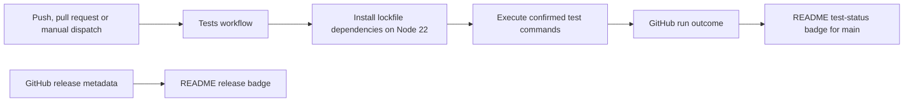

# Specification: Repository badges and test automation

- **Specification ID**: 015
- **Date**: 2026-10-19
- **Slug**: repository-badges-ci
- **Status**: Waiting Approve
- **Owner**: Repository documentation and development automation
- **Related Specification**: [014 — Fixed-size media cards and destination masks](014-2026-10-19-fixed-media-cards.md)

## Context & Background

The repository has a macOS Apple Silicon release, local-first storage, and an existing unit/integration test command. Its only GitHub Actions workflow deploys the landing page. The user rejected a downloads badge and requested both the proposed repository badges and test automation.

## Problem Statement

Visitors cannot see the latest release, supported platform or local-first storage at a glance. There is no automatic test status associated with GitHub changes, so a static passing label would not be evidence of a test run.

## Solution

Add a compact centered README row with release, macOS Apple Silicon, local-first and live test-status badges. The release badge reads GitHub release metadata; the test badge reads the dedicated Tests workflow on `main`. Links lead to the latest release, installation instructions, local data documentation and workflow runs respectively. Downloads, license and coverage badges are excluded.

The test workflow runs for pushes to `main`, pull requests targeting `main`, and manual dispatch. It uses Node 22, lockfile installation, npm download caching, read-only repository permissions and a finite timeout. Test failures fail the job. It does not publish, alter releases or access personal app data.

**Confirmed coverage:** the user selected “Unitários e integração (recomendado)”. Run the existing `npm test` command on an Ubuntu runner with Node 22; Electron smoke tests remain a local macOS validation command and are not represented by this badge.

## Practical Gains & Operational Outcomes

Release information updates without editing README version numbers. Test status reflects the selected workflow, including failures; the landing-page deployment remains independent. The row communicates product facts without a downloads counter.

## User Stories

- [x] 1. As a visitor, I can identify the release, supported platform and local-first storage and follow relevant documentation.
- [ ] 2. As a contributor, I receive a failing GitHub check when the selected test command fails.
- [ ] 3. As a visitor, I see the actual test status for `main`, without a hard-coded success claim.

## Architecture Gate

### Bounded Context, Language and Ownership

This is repository delivery tooling, not an app bounded-context feature. A workflow run is the aggregate root owned by GitHub Actions. A badge is a read-only status query. No Electron business model is introduced.

| Public module / package | Owner and primary responsibility |
| :--- | :--- |
| `README.md` | Present four badges and accessible destination links |
| `.github/workflows/tests.yml` | GitHub Actions adapter orchestrating existing test commands |
| `docs/DEVELOPMENT.md` | Explain automated test coverage, triggers and local equivalents |
| `specs/015-2026-10-19-repository-badges-ci.md` | Record scope, verification and review |

No runtime `domain/`, `application/`, `infrastructure/` or `presentation/` package is added: no new app feature or business logic exists. The development workflow is an outer infrastructure adapter invoking existing command/application seams; it never becomes a dependency of production code. Each changed module has one responsibility and stays below the existing size limits.

### Aggregate and State Transitions

Runs transition from queued to running, then successful, failed, canceled or timed out. The badge reports GitHub's outcome; README does not manufacture a state. Commands are push/pull-request/manual workflow triggers, installation and existing test scripts. Queries are workflow status and latest release metadata. Domain events are GitHub workflow completion events; no app domain event changes.

### Ports, Adapters and IPC Contract

The command port is the repository's existing npm scripts; GitHub Actions is the execution adapter. Shields supplies release/static badge images; GitHub supplies the workflow-status image. No new library, app IPC channel, preload capability, storage schema, network path in the app or public domain API is added. External event input uses GitHub's native `push`, `pull_request` and `workflow_dispatch` contracts; repository permissions are read-only, with no secrets required.

## Implementation Decisions

Preserve the landing-page workflow and existing test commands. Use a native workflow badge tied to the specific workflow file and `branch=main`; do not label landing-page deployment as app tests. Use consistent flat badge styling and subdued colors for static information. Add explanatory development documentation in English. Use `ubuntu-latest`, Node `22`, `npm ci --ignore-scripts` and `npm test`, with a 10-minute job timeout. Unit/integration tests do not need the Electron/esbuild/ONNX installation scripts; no GUI executable, native helper or model download is required for this suite. Use the repository's existing `actions/checkout@v4` major and `actions/setup-node@v4`, with npm caching and checkout credential persistence disabled. No error suppression or conditional test skipping is added.

## Testing Decisions

The requested public seams are existing npm test commands and GitHub's workflow configuration/status contract. README edits are low-impact documentation and do not need implementation-mirroring unit tests. Validate workflow YAML before and after creation (Red: absent workflow rejected; Green: valid workflow parsed), execute the selected command locally, check diff whitespace and inspect badge/link configuration as document source. Record hosted execution separately: a local pass is not a GitHub run. No automated visual/DOM inspection is used.

| Layer | Verification |
| :--- | :--- |
| Domain/application | Existing selected test command; no domain changes |
| Infrastructure | Parse workflow YAML, check triggers/permissions/timeout and execute its test command locally |
| Presentation/documentation | Four accessible badge links; dynamic test source matches workflow file and `main` |
| Hosted integration | Requires publishing the branch/workflow; no hosted success claimed before a real run |

## Acceptance Criteria

- [x] 1. README has release, macOS Apple Silicon and local-first badges, with no downloads badge.
- [ ] 2. The Tests workflow runs the confirmed suite with Node 22, lockfile installation and failing exit propagation.
- [x] 3. README test status reads that workflow on `main` and links to its runs.
- [x] 4. Selected tests, YAML parsing and whitespace checks pass locally; hosted verification is recorded accurately.
- [x] 5. Development documentation, README review and formal code reviewer diagnosis/table are recorded.

## Out of Scope

No coverage measurement, additional product feature, runtime/dependency upgrade, app packaging/release, license change, deployment changes, branch protection or hard-coded passing badge. No commit or push is authorized for this new task by the earlier completed release request.

## Further Notes

The user's “faça os dois” authorizes badges and test automation. The explicit follow-up confirms unit/integration coverage at the existing `npm test` seam. The grilling decision frontier is settled; no new product or test seam is introduced. Final implementation approval follows the normal `Waiting Approve` lifecycle.

## Implementation Report — 2026-10-19

Changed `README.md` to add four accessible linked badges: latest release, unit/integration workflow status on `main`, macOS Apple Silicon and local-first storage. Created `.github/workflows/tests.yml` for `push`/`pull_request` targeting `main` and manual dispatch. The single Ubuntu job sets up Node 22, caches npm downloads, installs the lockfile with lifecycle scripts disabled, and invokes `npm test` directly. It has a 10-minute timeout, read-only contents permission and no persisted checkout credentials. Updated `docs/DEVELOPMENT.md` to explain the scope and distinguish the badge from Electron smoke validation. No runtime module, dependency, IPC, app data or deployment workflow changed.

Validation followed the agreed public configuration/command seams. Before creating the workflow, YAML loading failed with `ENOENT` (ignored `artifacts/015-ci-red.log`); after creation, YAML loading and test-job validation passed (`015-ci-green.log`). Further configuration checks verified all triggers, branch filters, read-only permissions, Node 22, lockfile installation, timeout and direct test execution without error suppression (`015-workflow-check.log`). README source checks verified four accessible badge links, workflow-file/branch correspondence and existing local documentation targets. No rendered HTML or DOM was inspected.

`npm test` passed all 287 tests in the working checkout (`artifacts/015-unit.log`). A separate clean tracked-source copy under ignored `artifacts/015-clean-install/` installed 349 packages using the exact workflow install command, with an isolated npm cache (`015-clean-install.log`); its subsequent `npm test` passed all 287 tests without generated Electron/native/model executables (`015-clean-unit.log`). Both command checks used local macOS Node 22.23.1; an Ubuntu-hosted execution has not yet occurred. `git diff --check` passed. No JavaScript/CJS file changed, so syntax checks on changed JS files do not apply. App smoke/packaging checks do not apply to documentation and workflow-only changes.

README reviewed: added the requested badge row; existing descriptions, screenshots, Mermaid diagrams, commands and versions need no other change. No specifications index is present. Existing user guidance remains accurate. No scope divergence was introduced. Changes remain uncommitted on `codex/015-repository-badges-ci`; neither the badges nor workflow are published to GitHub yet. The unchecked hosted user stories and criterion 2 require publishing and observing a real GitHub run; no passing hosted result is claimed.

## Formal Code Reviewer Diagnosis — 2026-10-19

The explicit reviewer stance followed the implementation report and completed local verification. No implementation changes were applied during review. The audit traced native event/branch semantics, Node-version selection, cache/lockfile correspondence, lifecycle-script suppression against a clean install and complete unit suite, direct failure propagation, runner timeout, checkout/token permissions and badge source/destination consistency. The Pages workflow remains unchanged; `pull_request` is used rather than privileged `pull_request_target`, and no secrets or write token permission are introduced. The workflow and documentation each retain one responsibility, with no production dependency on delivery tooling. IPC, SQLite, quit flushing and app listener lifetimes are unchanged.

| CURRENT IMPLEMENTATION | PROBLEM | IMPROVEMENT (GAIN) |
| :--- | :--- | :--- |
| The dedicated read-only test workflow invokes the verified installation/test commands; the README queries its status on `main`. | No actionable defect or boundary violation was found. Hosted execution is pending publication, as explicitly documented. | No further code change proposed. Observe the first hosted run after an authorized push. |

No actionable defects or boundary violations found after rigorous audit. No automatic corrections were made during this review. Status is `Waiting Approve`; final approval and publication remain separate user decisions.

### Acceptance Evidence

- Criterion 1 / story 1: README source and destination/anchor checks confirm the three product/release badges and no downloads badge.
- Criterion 3: source check confirms the exact workflow filename and `branch=main` in the native badge URL, with a link to that workflow's runs.
- Criterion 4: YAML/contract checks, two 287-test passes including clean installation, and whitespace validation; hosted outcome explicitly unverified.
- Criterion 5: development documentation and the report/review above.
- Criterion 2 / stories 2–3: workflow configuration and commands verified locally; actual hosted check/status observation remains pending publication.

## Explicit Approval and Publication Authorization — 2026-10-19

The user explicitly requested “commit push” and then “approved”. This approves specification 015 and authorizes committing, pushing the dedicated branch and fast-forward integration into `main`. The implementation and formal review remain unchanged. Final status and hosted acceptance evidence will be recorded after observing the first GitHub Actions run.

Pre-commit documentation review: README reviewed, badge row added as specified; existing descriptions, screenshots, diagrams, commands and versions need no other change. There is no specifications index. Development documentation already describes the workflow; user-guide behavior is unchanged. No specification divergence is open.
