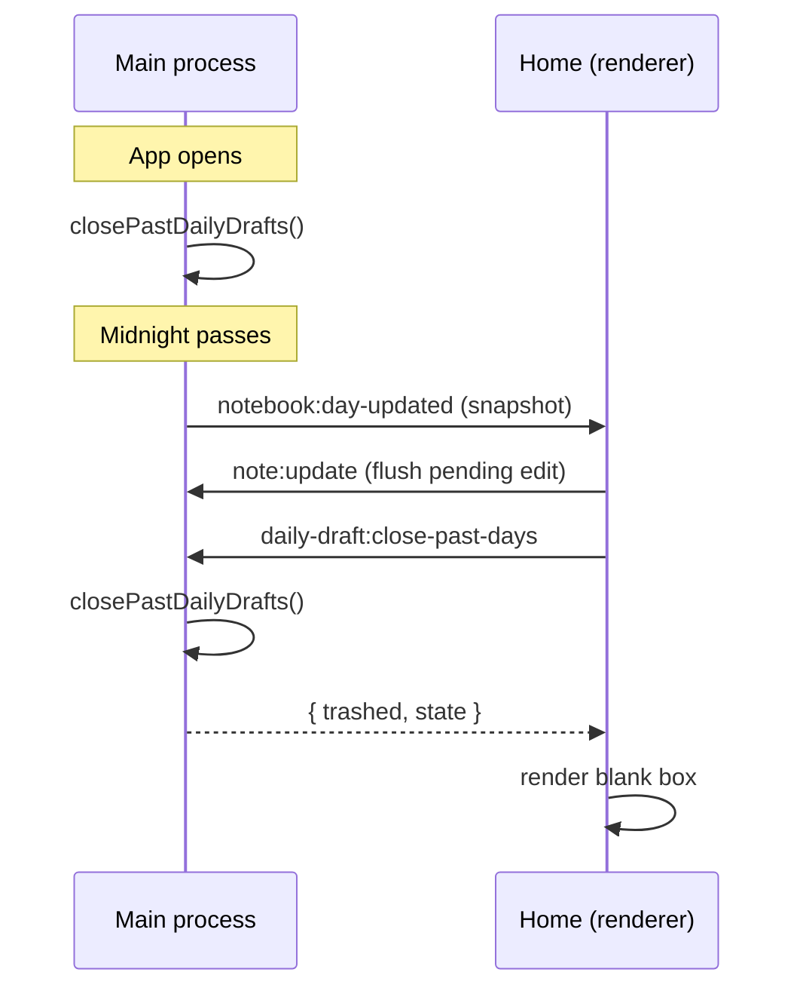

# Specification: Empty daily notes go to the trash when the day turns

- **Specification ID**: 017
- **Date**: 2026-11-22
- **Slug**: empty-daily-note-trash
- **Status**: Waiting Approve
- **Owner**: Daily draft context (`src/main/daily-draft/`, `src/renderer/home/home-page.js`)
- **Related Specification**: [012 — Attached sidebar and daily home](012-2026-10-15-attached-sidebar-and-daily-home.md), [016 — Untitled daily note and link to the note](016-2026-11-01-daily-note-title-and-link.md)

---

## Context & Background

Specification 012 created the **Nota do dia**: an ordinary note created on the first typed character and mapped to `(notebook, day)` in `daily_drafts`. Specification 016 made it untitled. An untouched box never creates a note, but a note that was started and then erased stays forever as an empty "Sem título" note in Notas, Últimas notas and search.

The user asked (2026-11-22) that an empty daily note go to the trash when the day turns. The decisions below were settled in a grilling round with the user on the same date.

---

## Problem Statement

### 1. Erased daily notes stay as empty notes

Typing one character creates the note; erasing it saves an empty body (`note:update`). Nothing ever removes it, so each such day leaves an empty untitled note behind.

### 2. The day change runs before the last save

At midnight the main process sends `notebook:day-updated`; only then does the renderer flush the pending daily note edit (`flushHomeDraft`). Trashing in the main process at that moment would make the flush hit a trashed note (`note:update` refuses with "Restaure a nota antes de editar.") and lose the last keystrokes.

---

## Solution

1. A daily note of a **past day** is **empty** when its title is empty, its body is blank (only whitespace) and it has no active media card. Empty past daily notes go to the trash.
2. The rule covers every past day in every notebook, and applies whatever the place the note was edited (home box or note page). Today's daily note is never touched.
3. The sweep runs in the main process:
   - when the app opens, before the window loads (covers the app closed overnight or for days);
   - at the day change, called by the renderer through a new IPC channel **after** it has flushed the pending daily note edit.
4. The note goes to the trash like `note:trash` does: `trashed = 1`, `deleted_at`, `updated` and a `trash` activity event. It appears in **Lixeira** and can be restored. No toast.
5. Trashing also removes the note's `(notebook, day)` mapping, so a note the user restores is an ordinary note and is not swept again.



---

## Practical Gains & Operational Outcomes

1. **Clean note lists**:
   - *Before*: every started-then-erased daily note stays as an empty "Sem título" note.
   - *Now*: it goes to the trash once its day is over.
2. **No data loss at midnight**:
   - *Before*: (not applicable; nothing was swept).
   - *Now*: the sweep runs only after the last pending edit was saved, so a note that got text in its last 400 ms is kept.

---

## User Stories

- [x] 1. As a writer, I want a daily note I erased to go to the trash when the day turns, so that my lists have no empty untitled notes.
- [x] 2. As a writer, I want a past daily note with text, a title or a media card kept, so that nothing I wrote is removed.
- [x] 3. As a writer, I want today's daily note never swept, even when empty, so that I can keep writing in it.
- [x] 4. As a writer, I want empty daily notes of every notebook and of every past day swept, so that days the app was closed are also cleaned.
- [x] 5. As a writer, I want the swept note in the Lixeira, restorable, so that a mistake can be undone.
- [x] 6. As a writer, I want a restored daily note to stay restored, so that the app does not trash it again.
- [x] 7. As a writer, I want my last keystrokes before midnight saved before the sweep, so that a note that just got text is not trashed.

---

## Architecture Gate

### 1. Bounded Context & Ubiquitous Language
- **Context**: Daily draft (existing, spec 012). No new context.
- **Package Ownership**:
  - `domain/daily-draft.cjs`: the `isEmptyDailyNote` rule (pure).
  - `domain/ports.cjs`: repository port gains `pastDrafts(today)` and `trash(entry)`.
  - `application/close-past-daily-drafts.cjs` (new): the `closePastDailyDrafts` command.
  - `infrastructure/sqlite-daily-draft-repository.cjs`: SQLite implementation of the new port methods.
  - `presentation/ipc.cjs`: the `daily-draft:close-past-days` channel.
  - `compose.cjs`: wires the new use case.
  - `src/main/store.cjs`: `Store.trashNote(id, stamp)`, the one note trash shared by `note:trash` and the sweep.
  - `src/main/main.cjs`: runs the command at startup and wraps it for IPC.
  - `src/main/preload.cjs`: `dailyDraftClosePastDays()`.
  - `src/renderer/home/home-page.js`: calls it after the flush on `notebook:day-updated` (presentation only).
- **Ubiquitous Terms**:
  - `Past daily note`: a daily note whose mapped day is before today.
  - `Empty daily note`: title `''`, body blank after trimming whitespace, no active media card.
  - `Close past days`: trash every empty past daily note and drop its mapping.

### 2. Aggregate Root & State Transitions
- `DailyDraft { notebookId, day, noteId }`: `blank → live` (spec 012), and now `live (past, empty) → closed` (note trashed, mapping removed).
- **Invariants**:
  - Today's daily note is never trashed by the sweep.
  - A note with a title, text or an active media card is never trashed by the sweep.
  - Trash and mapping removal happen in one transaction.
  - The sweep is idempotent: running it twice trashes nothing the second time.

### 3. Commands, Queries & Domain Ports
```javascript
/** @typedef {{ notebookId: string, day: string, noteId: string, title: string, body: string, media: number }} PastDraft */
/** @typedef {{ today(): string, transaction<T>(work: () => T): T, pastDrafts(today: string): PastDraft[], trash(draft: PastDraft): void }} DailyDraftRepositoryPort (additions) */
/** closePastDailyDrafts() -> { trashed: string[] } */
```
`pastDrafts(today)` returns only mappings whose note is not trashed.

### 4. IPC Contract & External Input Validation
- **`daily-draft:close-past-days`** (new), preload `dailyDraftClosePastDays()`.
  - Payload: none. Any payload other than `undefined`, or a sender other than the app window, is refused with `Requisição inválida.` before the use case runs.
  - Result: `{ trashed: string[], state: Snapshot }`.
- `daily-draft:start`: unchanged.

---

## Implementation Decisions

1. Emptiness is decided in the domain (`isEmptyDailyNote`), not in SQL, so whitespace trimming matches JavaScript `trim()`.
2. `store.dispatch` opens its own transaction and SQLite transactions do not nest here, so the repository cannot dispatch `note:trash`. The trash itself (`trashed`, `deleted_at`, `updated`, activity event) lives in `Store.trashNote`, which runs inside the caller's transaction; `note:trash` and the repository's `trash` both call it, so the two paths cannot drift.
3. The startup run happens right after the use cases are created and before the window loads; a failure is reported through `reportSaveError` and does not stop the app.
4. The IPC wrapper in `main.cjs` follows the existing `dailyDraftCall` pattern and schedules related indexing after a sweep.
5. The renderer handler order is: `flushHomeDraft()`, then `dailyDraftClosePastDays()`, then render with the returned state. If the call fails, the toast shows the error and the day-updated snapshot is used.
6. New and Daily draft files stay under 250 lines; dependencies point inward. `src/main/main.cjs` (327 → 329 lines) and `src/main/store.cjs` (312 → 317 lines) were already above 250 before this specification; splitting them is left to a separate specification.

---

## Testing Decisions

### Integration Tests (`tests/daily-draft-store.test.cjs`, real `Store`, advanced clock)
- An erased past daily note goes to the trash with `deleted_at` and its mapping removed.
- Past daily notes with text, with a title or with an active media card are kept.
- Today's empty daily note is kept.
- Empty past daily notes of several notebooks and several days are all trashed; a second run trashes nothing.
- A restored swept note is not trashed by the next run.
- A swept note leaves the same trace (`trashed`, `deletedAt`, `updated`, trash activity event) as a note trashed with `note:trash`. This reads `activity_events` directly, as `tests/categories.test.cjs` does, since no public reader exists.

### IPC Contract Tests (`tests/daily-draft-ipc.test.cjs`)
- Both channels are registered once.
- `daily-draft:close-past-days` answers `{ trashed, state }`.
- Other senders and any payload are refused before the use case runs.

### Electron Smoke (`tests/smoke/run.cjs`, `npm run test:app -- --home-only`)
- Midnight scenario: the daily note is first saved empty, then a line is typed and the day turns while its 400 ms save is still pending. The note must keep the text and stay out of the trash. With the handler order inverted (sweep before flush) the scenario fails with the note trashed and "Restaure a nota antes de editar.", which was confirmed by a temporary mutation.

### Regression Tests
- The existing `npm test` suite and the home smoke scenario keep passing.

---

## Acceptance Criteria

- [x] 1. An empty past daily note is in the Lixeira after the day turns or the app opens.
- [x] 2. Past daily notes with a title, text or media card stay.
- [x] 3. Today's daily note is never swept.
- [x] 4. A restored swept note stays restored.
- [x] 5. The midnight sweep runs after the pending daily note edit is saved.
- [x] 6. All unit, integration and smoke tests pass.
- [x] 7. Quality checks (`npm test` on Node 22+, `node --check` on changed files) pass with 0 errors.

---

## Out of Scope

- Ordinary notes (not daily notes) that are empty.
- Permanent deletion; the sweep only moves to the trash.
- Daily notes erased **today**: they stay until the day turns.
- A sweep while the window is closed but the app keeps running (macOS); the next app open or day change covers it.

---

## Further Notes

- Supersedes nothing in 012 or 016; it adds the closing rule for past days.
- **TDD deviation**: the emptiness rule (title, body, media) was written whole in the first red-green cycle, so the keep-rule tests passed on first run. Each was confirmed by a temporary mutation (body-only rule; `<=` instead of `<` on the day) that made it fail.
- **Review round (2026-11-22)**: the user approved two review improvements. (1) The midnight smoke now starts from an empty saved note, so it proves the flush-then-sweep order. (2) The trash statement moved to `Store.trashNote`, guarded by a characterization test. A third finding (a queued note-page mutation at midnight) was not applied.
